# Hogwarts Mini

Упрощённая игра на Unity 6000.0.77f1: сюжет, заклинания, полёты на метле, испытания Хранителей, поручения профессоров, магазины и снаряжение.

## Запуск

Двойной щелчок по `LaunchGame.bat` запускает готовую игру. `BuildGame.bat` собирает её в `Build/HogwartsMini.exe` через установленную Unity 6000.0.77f1. Закройте этот проект в редакторе перед сборкой. Если Unity установлена в другом месте, передайте путь первым аргументом: `BuildGame.bat "D:\Unity\Editor\Unity.exe"`. Лог сборки: `Build/Verification/bat-build.log`. Оба батника работают независимо от текущей папки.

Для редактирования откройте `Assets/Scenes/Main.unity` в Unity и нажмите Play.

## Управление

| Клавиша | Действие |
| --- | --- |
| WASD, мышь | Движение и камера |
| Shift, Пробел, Ctrl | Бег, прыжок, перекат |
| ЛКМ, 1–4, Tab | Базовое заклинание, заклинания набора, смена набора |
| Q, F | Протего, Древняя магия |
| E | Разговор, сундук, переход через картину кухни |
| B | Метла; Пробел/Ctrl — вверх/вниз |
| I | Инвентарь |
| V | Карта: этажи, масштаб, перемещение, выбор цели |
| H/G/J/K/L/N/M/U | Зелья; M сохраняет грозовое зелье |
| Esc | Пауза / закрытие карты |

## Локации замка

- Двор, Большой зал, библиотека и класс ЗОТИ.
- Верхняя библиотечная галерея и Запретная секция.
- Астрономическая башня: винтовая лестница и обсерватория.
- Гостиная Гриффиндора, спальня, трофейный зал.
- Кухня под Большим залом. Во дворе, возле северо-восточного угла, подойдите к картине с фруктами и нажмите E. Внутри есть обратный переход.
- Северное крыло: лазарет, зельеварение, класс чар, оранжерея. Проход через дверь в задней стене трофейного зала.

Комнаты теперь работают: на кухне можно поесть (+40 HP раз в минуту), в лазарете полностью вылечиться за 50 галлеонов, в оранжерее собрать 6 трав раз в 3 минуты, в зельеварении сварить Вигенвельд, Фокусирующее или Грозовое зелье (2 травы + 30 галлеонов), в библиотеке изучить следующее обычное заклинание за 200 галлеонов, а в классе чар создать манекен. Откройте меню услуг на E. Во время боя услуги недоступны.

## Карта

Схема рисуется из координат помещений игры. Голубой квадрат — игрок, белая точка — направление взгляда, зелёный — сюжетная цель, жёлтый — выбранная локация. На V доступны подземелье, первый этаж, галерея, башня и окрестности; колесо меняет масштаб, правая кнопка перетаскивает карту. Мини-карта показывается во время игры.

Это упрощённая адаптация Хогвартса, а не точная копия карты из фильма или Hogwarts Legacy. Расположение кухни под Большим залом и вход через картину взяты из [официального описания кухни](https://www.harrypotter.com/fact-file/locations/hogwarts-kitchens); соседство кухонного коридора с Пуффендуем подтверждает [текст Дж. К. Роулинг](https://www.harrypotter.com/writing-by-jk-rowling/hufflepuff-common-room). Изображения оригинальной карты не копировались.

## Скриншоты и проверка

Проверено 12 октября 2026:

- Сборка Windows: Succeeded, 0 ошибок.
- Полное автоматическое прохождение: сюжет до Free, 3/3 испытания, 7/7 поручения, смерть и возрождение; 0 ошибок. В этом прогоне около 45 FPS; это измерение на текущем компьютере, не гарантия производительности.
- После финальных правок кухни и карты повторена отдельная проверка: 17 зон, пол под точками входа, кухонный переход туда/обратно, подъём по обеим лестницам настоящим CharacterController, проход через северную дверь и вход в четыре комнаты, выбор цели, проекция карты, пауза и возврат управления. Exit 0, errors=0.
- Изображения ниже просмотрены. Логи: [сборка](docs/verification.md), [сюжет](docs/verification.md), [локации](docs/verification.md).

### Карта первого этажа

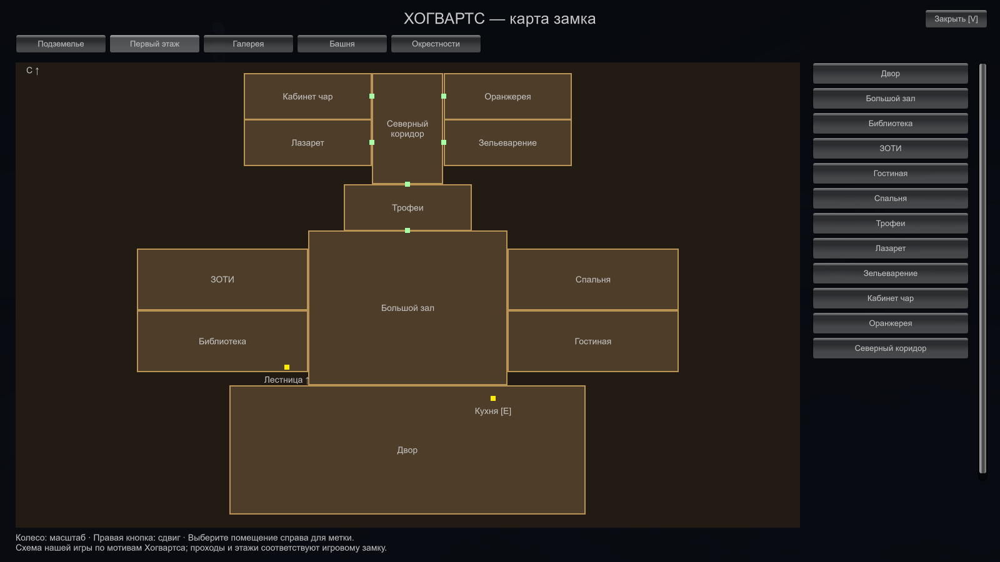

### Библиотечная галерея

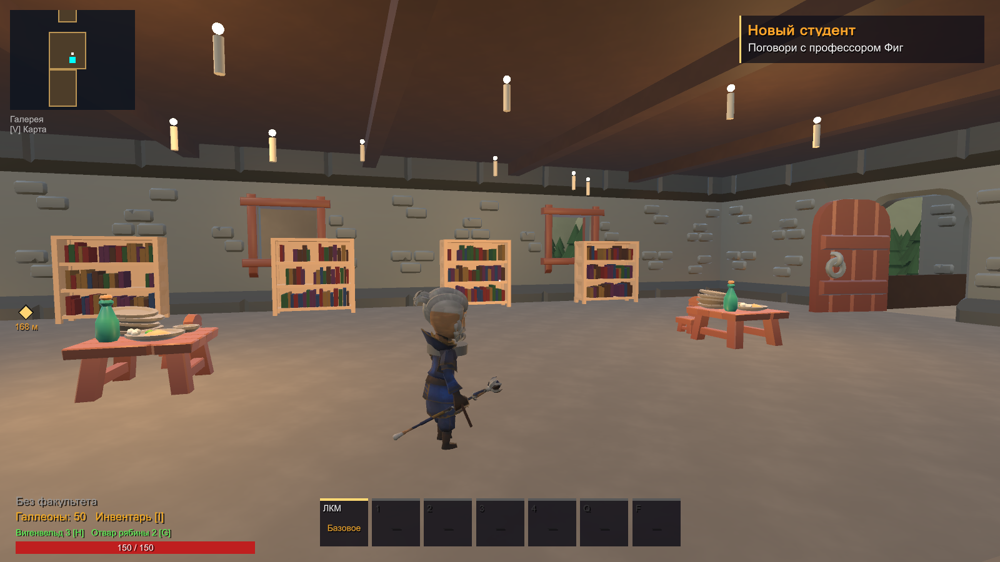

### Кухня под Большим залом

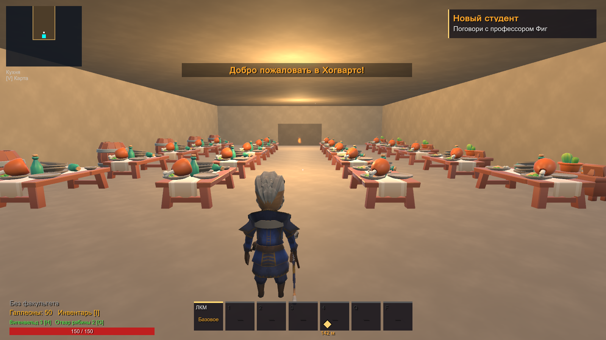

### Лазарет

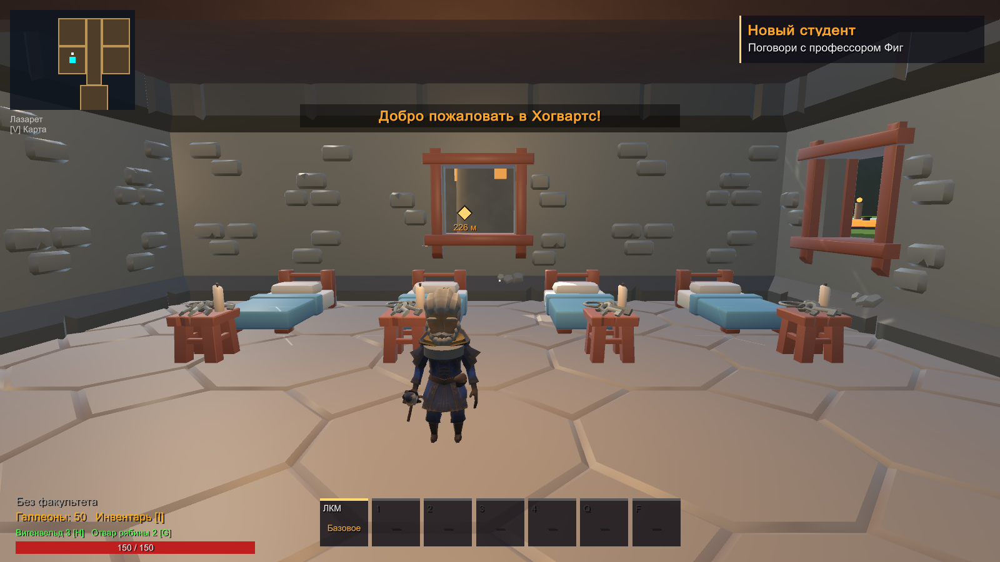

### Зельеварение

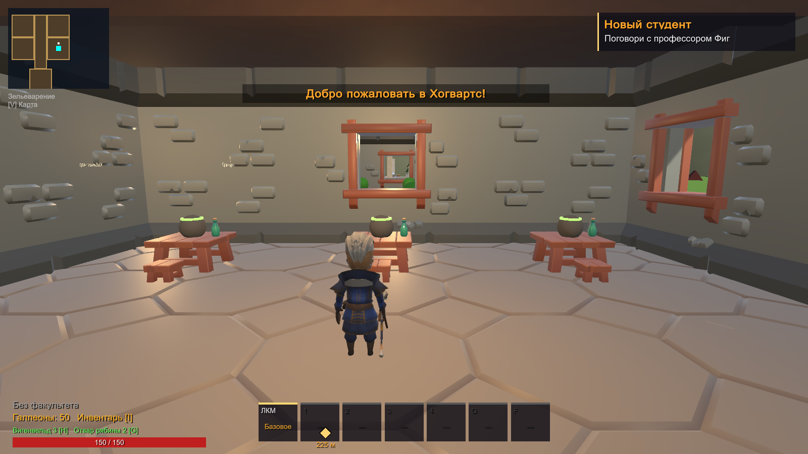

### Оранжерея

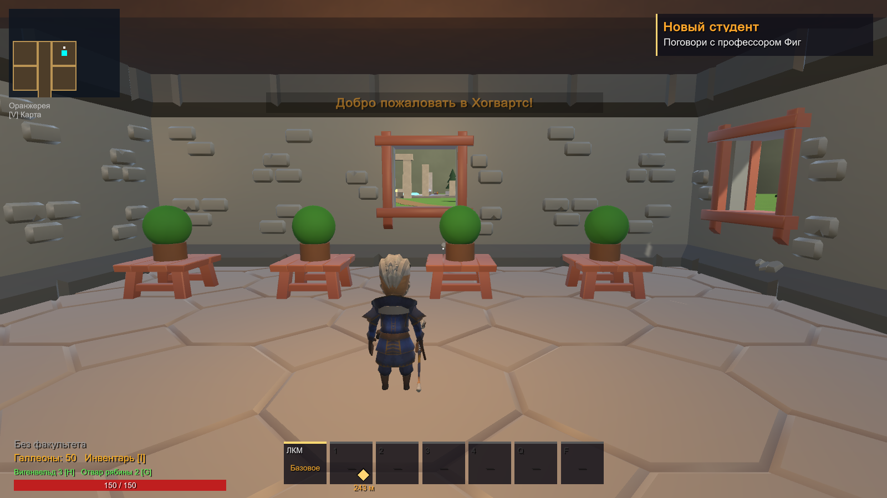

### Обсерватория

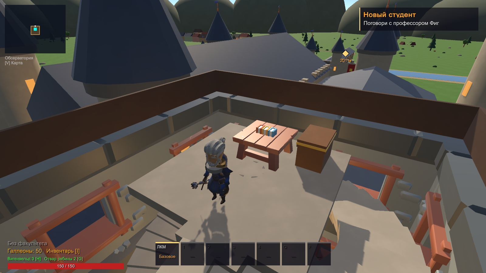

Дополнительные схемы: [галерея](docs/screenshots/gallery-map.png), [кухня](docs/screenshots/kitchen-map.png).

### Повторить проверку

Запустите `Build/HogwartsMini.exe` с `-hmSmoke -hmShots docs/new-shots -logFile docs/verification.md`. Для проверки только помещений добавьте `-hmLocationsOnly`. Это автоматический режим: он перемещает персонажа, проходит задания и закрывает игру по завершении.

## Ассеты

Использованы бесплатные модели и аудио Kenney, KayKit, Quaternius и OpenGameArt. Сведения об авторах: `Assets/Models/CREDITS.txt`, `Assets/Resources/Castle/CREDITS.txt`, `Assets/Resources/Audio/CREDITS.txt`.

## Новая глава: «Эхо хранилища»

После Ранрока история продолжается, а экран победы появляется после завершения новой главы:

1. Пепел победы — разговор с Фигом.
2. След в Запретной секции — хроника на верхнем этаже библиотеки.
3. Сова без адреса — записка на кухне.
4. Перехват каравана — бой на восточной дороге.
5. Пленник леса — спасение исследователя через зачистку стражи.
6. Три печати Хогвартса — библиотека, обсерватория, оранжерея.
7. Сердце разлома — Пожиратель эха, босс с 2000 HP.
8. Новый хранитель — заключительный разговор и свободная прогулка.

## Больше монет

| Источник | Теперь |
| --- | --- |
| Тёмный маг | 60–104 галлеона |
| Паук | 32–56 |
| Тролль | 280 |
| Страж | 360 |
| Ранрок | 1600 |
| Пожиратель эха | 2400 |
| Обычный сундук | 120–359 |

Выпадает до 16 видимых монет за раз, общая сумма делится между ними. Феликс по-прежнему удваивает награду. Награда за основной шаг: 100 + номер шага × 25; финальное завершение — 2000. Особые квестовые враги могут иметь свою награду.

## Сохранения и летучий порох

- F5 — сохранить вне боя; F9 — загрузить вне боя или с титульного экрана. Enter на титульном экране начинает новую игру.
- Раз в минуту вне боя игра автоматически сохраняет прогресс; при выходе из активной игры вне боя тоже сохраняется.
- Сохраняются этап сюжета, деньги, инвентарь и экипировка, заклинания, HP, позиция, факультет, выполненные испытания и поручения, открытые сундуки, собранные страницы, печати новой главы, травы, таймеры сбора и питания и посещённые комнаты.
- Частично выполненные обычные поручения и незавершённый пролёт колец после загрузки нужно начать заново. Временные эффекты зелий сбрасываются. Завершённые поручения не выдают награду повторно.
- Слот: файл `progress-v1.json` в системной папке сохранений Unity; предыдущая запись сохраняется рядом как `.bak`. Повреждённый файл не загружается. Автотест пишет отдельный `Build/Verification/test-progress.json` и не трогает пользовательский слот.
- На карте выберите уже посещённую комнату и нажмите «Летучий порох»: перемещение стоит 25 галлеонов. Не работает во время боя и испытаний.
## Проверка расширения

Проверено 12 октября 2026:

- `BuildGame.bat`: успешная сборка; путь к Unity с пробелами обрабатывается. При неверном пути батник возвращает ошибку с понятным сообщением.
- `LaunchGame.bat`: запуск игры с аргументами проверки.
- Полный расширенный сюжет: 0 ошибок, финальная свободная прогулка, испытания 3/3, поручения 7/7, смерть и возрождение. Прогон занял 274 секунды (около 41 FPS на этом компьютере).
- Финальная отдельная проверка: увеличенная награда и сбор монет, сбор трав и его задержка, варка зелий и отказ без ингредиентов, изучение заклинания и стоимость, питание и его задержка, стоимость и точка быстрого перемещения.
- Проверены запрет сохранения и быстрого перемещения в бою, запись/загрузка денег и прогресса, восстановление HP без экипировки, сохранение завершённых поручений, отклонение повреждённого файла без изменения текущей игры. `HM_FEATURE_RESULT errors=0`.
- Логи: [расширенное прохождение](docs/verification.md), [финальные проверки функций](docs/verification.md), [сборка](docs/verification.md).

Последние изменения после полного прогона касались восстановления максимального HP при отсутствии экипировки; после них сборка и отдельная проверка функций выполнены повторно.

### Новая глава: расследование в библиотеке

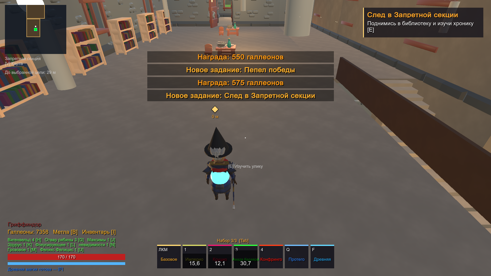

### Новый финальный противник

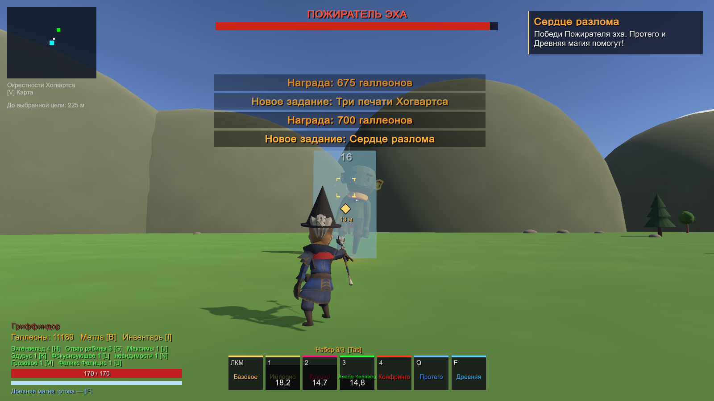

### Работающий кабинет зельеварения

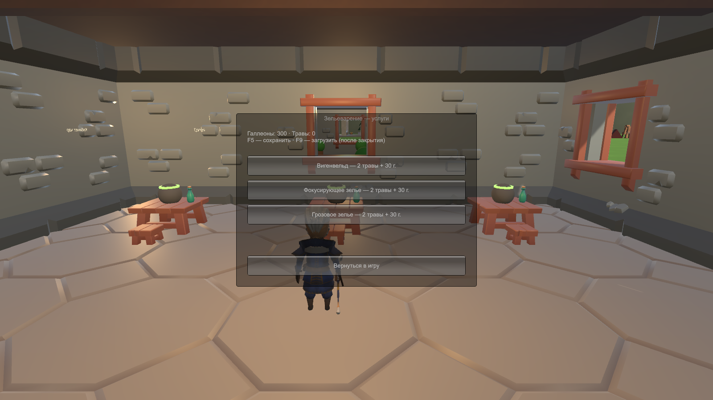

### Загрузка сохранённого прогресса

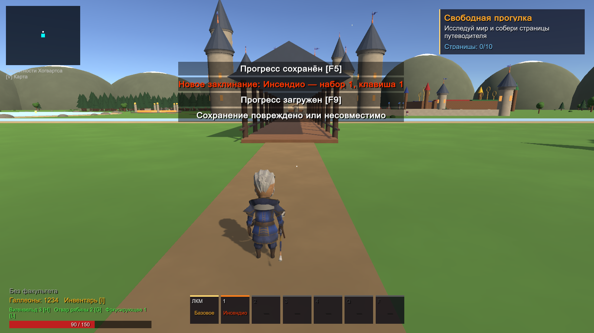

Сообщение о повреждённом сохранении на этом кадре получено намеренно: тест сначала успешно загрузил прогресс, затем проверил отказ загрузки испорченного файла. Деньги и состояние игры при отказе сохранились.

Для отдельной проверки функций: `LaunchGame.bat -hmSmoke -hmFeaturesOnly -hmShots docs/feature-shots -logFile docs/verification.md`. Этот режим проверяет функции на подготовленном состоянии; полный сюжет проверяется обычным `-hmSmoke`.